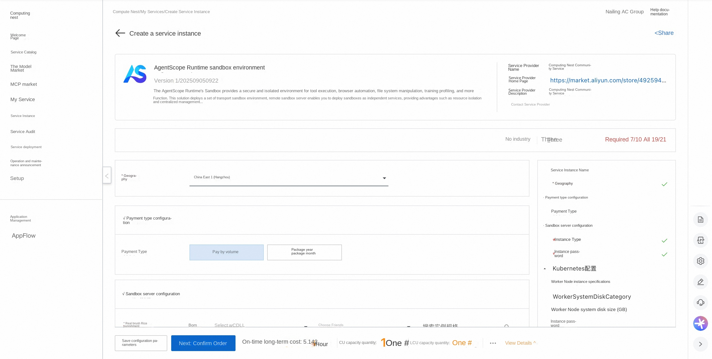
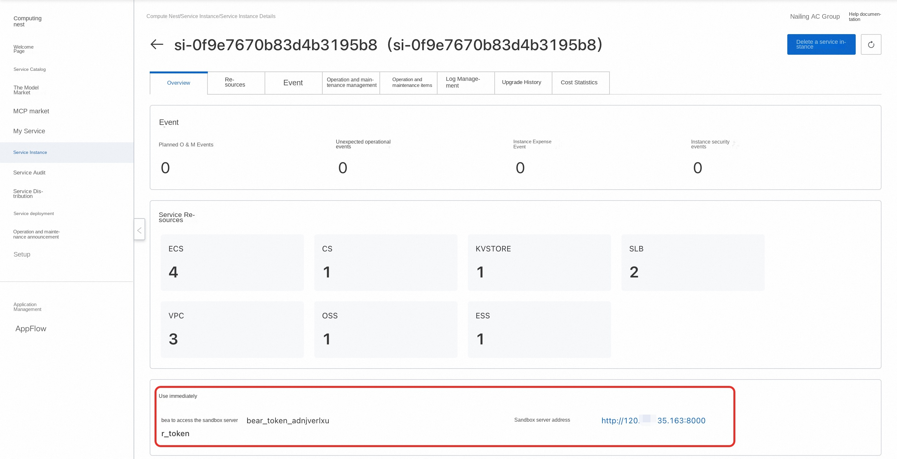
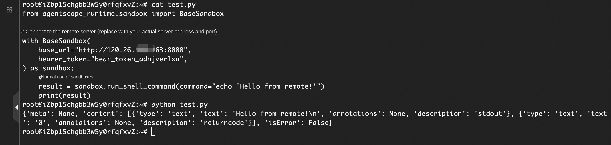
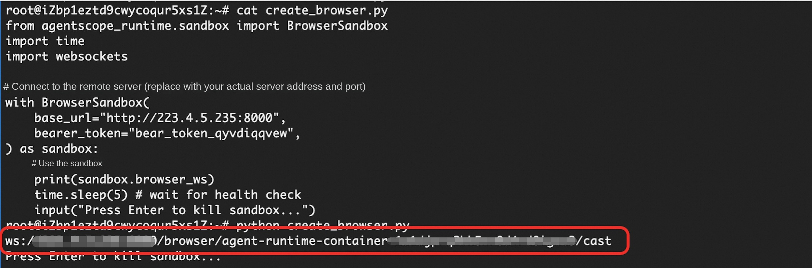
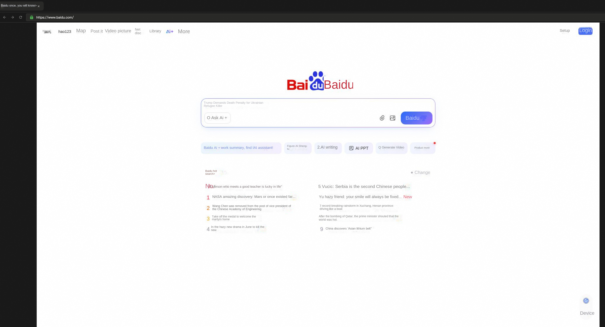
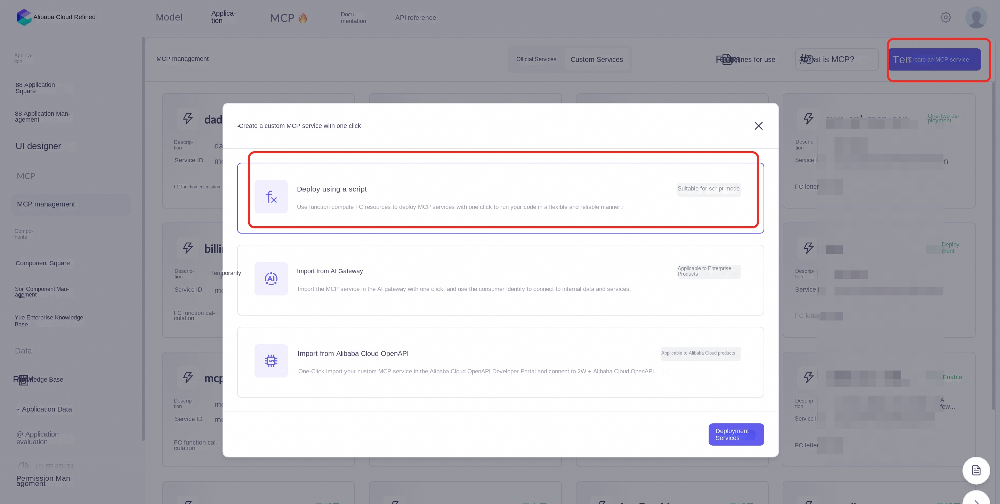
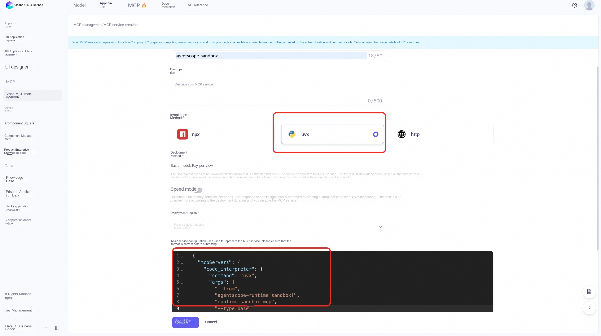
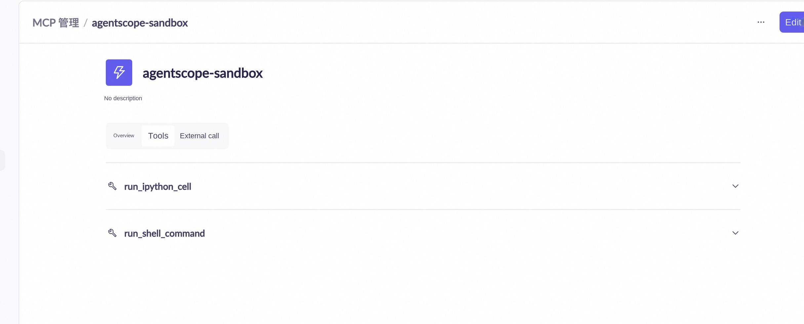
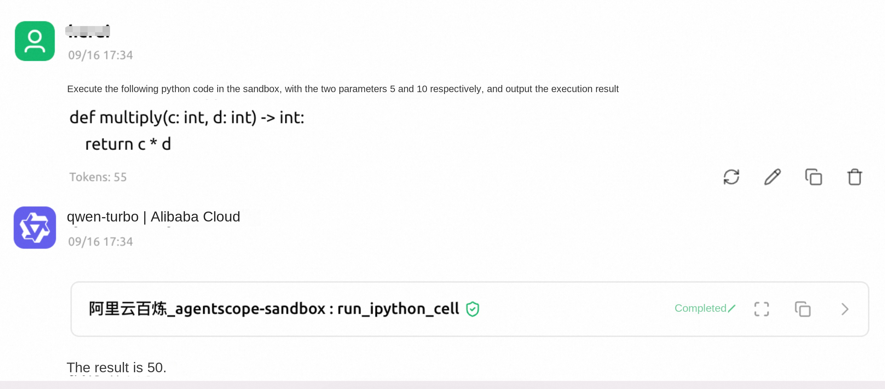

# AgentScope Runtime sandbox environment for rapid deployment

## Overview

AgentScope Runtime Sandbox provides a secure and isolated environment for tool execution, browser automation, file system manipulation, training profiling, and more. This solution deploys a transport sandbox environment. The remote sandbox server enables you to deploy the sandbox as an independent service, providing advantages such as resource isolation and centralized management. You can connect to the remote sandbox server through the sandbox SDK. Visit [AgentScope Runtime website](https://runtime.agentscope.io/zh/intro.html) for details.

## Deployment process

1. Access the service [Deployment Link](https://computenest.console.aliyun.com/service/instance/create/cn-hangzhou?type=user&ServiceId=service-7029e12746fa424db3f3) and fill in the deployment parameters as prompted:

2. After completing the parameters, you can see the corresponding RFQ details. After confirming the parameters, click **Next: Confirm Order**. Confirm the order and agree to the service agreement and click **Create Now** to enter the deployment phase.

3. After the deployment is complete, go to the service instance overview page, you can see the address of the sandbox server and the bear_token of accessing the sandbox server.

## Use example

### The sandbox type is Python code and Shell command execution
1. Connect to the sandbox server remotely (you can also operate on this machine), refer to [official documents](https://runtime.agentscope.io/zh/install.html)
Install the stable version of the Agentscope Runtime, create the script and run it.

The sample script is as follows:
'''python
from agentscope_runtime.sandbox import BaseSandbox

# Connect to the remote server (replace with your actual sandbox server address and bear_token)
with BaseSandbox (
base_url = "Sandbox Server Address",
bearer_token = "Sandbox Server bear_token",
) as sandbox:
# Normal use of sandbox
result = sandbox.run_shell_command(command="echo 'Hello from remote! '")
print(result)
'''

### Sandbox type for web browser automation
1. Connect to the sandbox server remotely (you can also operate locally) refer to [Official Documents](https://runtime.agentscope.io/zh/install.html)
Install the stable version of the Agentscope Runtime, create the script and run it.

The sample script is as follows:
'''python
from agentscope_runtime.sandbox import BrowserSandbox
import time
import websockets

# Connect to the remote server (replace with your actual sandbox server address and bear_token)
with BrowserSandbox (
base_url = "Sandbox Server Address",
bearer_token = "Sandbox Server bear_token",
) as sandbox:
# Normal use of sandbox
print(sandbox.browser_ws)
time.sleep(5) # wait for health check
input("Press Enter to kill sandbox...")
'''

2. After creating the sandbox, you will get a websocket connection. Through this websocket connection, you can access the functions of the browser_use. You can copy the obtained websocket connection and replace it with the baseWsUrl of line 547 in the following sample HTML. If you access this html, you can access the sandbox browser.
URL can be accessed in the address bar

[Sample HTML](https://computenest-service-deploy-document-cn-hangzhou.oss-cn-hangzhou.aliyuncs.com/quickstart-agentscope-runtime/example.html)

### Call the sandbox service through MCP
1. After the sandbox environment is successfully deployed, you can create a corresponding MCP server and call the sandbox service through MCP. This section describes the process of creating an MCP server and using it. Create an MCP server in Bailian and use the method of script creation.

2. Configure the information of the MCP server. Select uvx as the installation method. MCP service configuration uses the following Json, where base_url is the address of the sandbox server and bearer_token is the bear_token of the sandbox server.

'''json
{
"mcpServers ": {
"code_interpreter": {
"command": "uvx ",
"args ": [
"--from ",
"agentscope-runtime[sandbox] ",
"runtime-sandbox-mcp",
"--type=base ",
"-- base_url = http:// sandbox server address: 8000",
"--bearer_token=xxx"
]
}
}
}
'''
3. After creating MCP Server successfully, you can view the tool list of MCP Server

4. After the MCP Client is configured successfully, the Agent can call the sandbox service through the MCP Server. For example, as shown in the following figure, the python script is executed through the sandbox.

For more usage, please refer to [official example](https://runtime.agentscope.io/zh/api/index.html).
